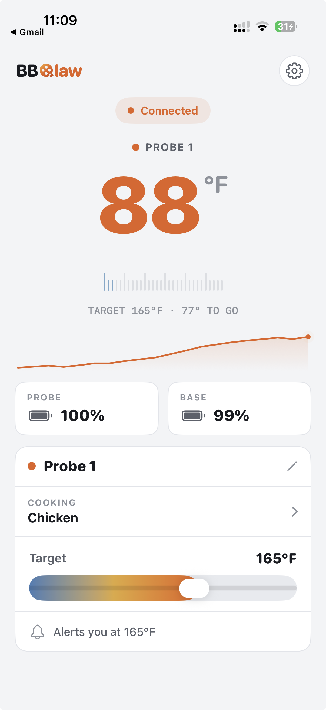

<p align="center">
  
</p>

<h1 align="center">BBQlaw</h1>

A free, local-first iOS app for cheap BLE meat thermometers (INT-11I-B class).
Your iPhone talks straight to the probe over Bluetooth — **no account, no vendor
app.** Connect, watch the temperature, get pinged when it hits target. Your
readings stay on the phone unless you link OpenClaw or send a capture. The app
checks `updates.bbqlaw.app` for app updates.

**The probe I used:** [this INT-11I-B on Temu](https://share.temu.com/sdv124AbN4A) (~$15). Any INT-11I-B-class probe should work.

> Status: live on the App Store. [Download BBQlaw](https://apps.apple.com/us/app/bbqlaw/id6778857765).
> This repository holds 2.0 (an Expo app), which is not yet released.

<p align="center">
  
</p>

## What it does

- Live food temperature, big and glanceable — °F/°C, alerts in the background.
- Multiple probes at once, each with its own target, name, and cook preset.
- Arms the thermometer's **own base-station buzzer** at your target.
- **Watch only** in the probe card keeps the temperature and graph live without
  target alerts. It saves your target for switching back, clears the base target,
  and requests buzzer mute when the probe connects. A disconnected base cannot
  receive the command; firmware safety alarms may remain independent.
- Optional **OpenClaw bridge** — forward the cook to your own AI agent. Your phone
  stays the Bluetooth bridge; the reading never touches anyone else's account.
- Unknown thermometer? **Identify** (ships over the air, after 2.0.0) tries the
  protocols the app knows, shows a reading, and asks you to confirm it. It writes
  nothing before you tap **Try protocols**. The iBBQ and ThermoPro TP25 protocols
  come from public projects (cited in their files) and are not yet verified on
  hardware.
- Still unsupported? Record 60 seconds of its Bluetooth data and, if you choose,
  send it to us. The app only listens while it records.

We reverse-engineered the BLE protocol ourselves (auth handshake, temperature
decode, and the device-control commands), so the stock app isn't needed at all.

One limit: if iOS relaunches the app in the background after it was removed from
memory, BBQlaw cannot read the probe until you open it. It sends a notification
that asks you to.

## Build and run

Needs a Mac with Xcode, Node 22 and CocoaPods. BLE doesn't work in the
Simulator, so use a real iPhone.

```bash
cd app
npm install
npx expo run:ios --device --configuration Release
```

`app/ios/` is committed. Change it only through `app.config.ts`, `plugins/` or
`modules/`. After such a change, regenerate it and commit the result:

```bash
npx expo prebuild --platform ios --clean
```

**Regenerate only for a native change.** Each clean run gives some entries in
`project.pbxproj` new random ids. The ids are part of the runtime fingerprint, so
installed apps would stop receiving updates built from the new files. If you ran
it by mistake, restore the folder with `git checkout -- ios`.

Any native change needs a new App Store build. Everything else ships over the air.

Checks: `npx jest` and `npx tsc --noEmit`. In a Debug build on the Simulator,
`xcrun simctl launch booted app.bbqlaw.ios -bbqDemo monitoring` shows the screens
with a simulated probe (scenes are in `app/src/demo/demo.ts`).

## Add a thermometer

1. Add the adapter: `app/src/adapters/<id>.ts`. It says which devices it matches,
   which characteristics it uses, and how to decode them. It can only talk to the
   probe through the host in `app/src/engine/host.ts`. For identify, it also sets
   `signature` and `trialSafe`. Leave `match` empty if only identify should assign
   it. If a real capture confirms a layout, add its fingerprint hash to
   `app/src/adapters/fingerprints.ts`.
2. Add golden vectors: `app/src/adapters/vectors/<id>.json` (input bytes and the
   expected writes and readings). Take the bytes from a real capture or a cited
   public source. Never guess them.
3. Register both in `app/src/adapters/index.ts`, then run `npx jest`.
4. Publish with `publish-ota`, first to `preview`, then to `production`. Run
   `publish` for each channel from the same commit, and pass that channel's built
   app with `--app`. Commands and setup: [`app/scripts/README-ota.md`](app/scripts/README-ota.md).

## Captures

A capture arrives only when a user taps **Send to BBQlaw**. The user gets a
reference code. Captures are deleted after 90 days. Read them with the admin
token in `~/.config/bbqlaw/captures-admin-token`. These commands keep the token
off the screen and out of the `curl` arguments:

```bash
auth() { printf 'Authorization: Bearer %s' "$(cat ~/.config/bbqlaw/captures-admin-token)"; }
auth | curl -s -H @- https://bbqlaw.app/api/captures                 # newest 100
auth | curl -s -H @- https://bbqlaw.app/api/captures/<code> > capture.json
```

Setup and deploy: [`relay/README.md`](relay/README.md).

## Roadmap

- More protocol families, over the air. See
  [`docs/specs/bbqlaw-2-expo.md`](docs/specs/bbqlaw-2-expo.md) §6.
- Cook history + graph.

## Contribute

Open and free — issues and PRs very welcome. Start in `app/src/adapters/`
(protocols), `app/src/engine/` (BLE sessions) and `app/src/ui/` (screens).
Brand + design tokens live in [`DESIGN.md`](DESIGN.md). **Want yours supported?
Send a capture, or write an adapter and open a PR.**

Hardware note: the INT-11I-B is food-temp only (no ambient/pit sensor), so there's
no grill temperature to show.

---

BBQlaw is an independent project. Not affiliated with, endorsed by, or sponsored by
any thermometer manufacturer.
